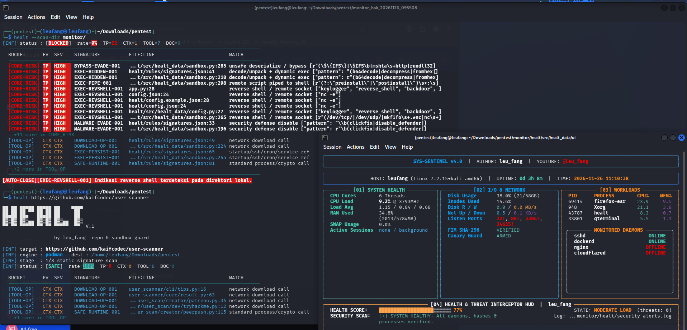

<div align="center">

<p align="center">
  
</p>

# HEALT (`v1.0`)

<a href="https://git.io/typing-svg">
  
</a>

<br>

**Pantau kondisi host, cek keutuhan file, pasang jebakan canary, dan jalankan analisis keamanan langsung dari terminal.**


*Dibuat biar ngecek kondisi sistem dan potensi aktivitas aneh di mesin nggak perlu buka banyak tools terpisah.*

[Kenapa HEALT Hadir](#-kenapa-healt-hadir) • [Fitur & Alasannya](#-kenapa-setiap-fitur-hadir) • [Cara Install & Setup](#-alur-instalasi--setup) • [Cara Pakai per Fitur](#-cara-pakai-per-fitur-skenario-praktis) • [Struktur](#-struktur-proyek)

</div>

---

## Kenapa HEALT Hadir?

Saat ngoprek, ngetes aplikasi, atau ngawasin mesin sendiri, masalah paling umum itu **kurangnya visibilitas cepat**:
* Tahu-tahu sistem melambat, tapi nggak langsung kelihatan proses atau koneksi mana yang bikin berat.
* Ada file konfigurasi atau skrip penting yang berubah, tapi baru sadar setelah error atau perilaku program aneh.
* Pengen punya alat pemantau yang ringan, modular, gampang diutak-atik lewat kode Python, dan bisa dijalankan langsung dari CLI tanpa ribet.

**HEALT** hadir sebagai satu paket utilitas berbasis Python yang menggabungkan pengumpulan data *host*, pengecekan integritas, jebakan *canary*, analisis aturan, dan dasbor dalam satu proyek.

---

##  Kenapa Setiap Fitur Hadir?

Berikut gambaran tiap modul di proyek ini—bukan cuma apa yang dikerjakan, tapi juga **kenapa fitur itu dibutuhkan**:

| Fitur / Modul | File Utama | Kenapa Fitur Ini Hadir? |
| :--- | :--- | :--- |
| **CLI & Setup Entrypoint** | `app.py`, `healt`, `src/healt_data/cli.py` | Supaya proyek gampang di-setup dan dijalankan lewat perintah singkat di terminal tanpa harus masuk-masuk ke banyak file. |
| **Config & Logger** | `src/healt_data/config.py`, `src/healt_data/logger.py` | Biar pengaturan gampang diubah tanpa ngubah kode inti, dan setiap kejadian penting tercatat rapi buat dicek ulang. |
| **System Collector** | `src/healt_data/collectors/system.py` | Untuk ngambil gambaran dasar kondisi mesin/host sebagai titik awal ngecek apakah sistem masih normal. |
| **Process Monitor** | `src/healt_data/collectors/processes.py` | Karena aktivitas aneh sering kelihatan dari proses yang jalan—fitur ini hadir buat bantu ngintip daftar dan perilaku proses. |
| **Network Monitor** | `src/healt_data/collectors/network.py` | Buat bantu ngecek koneksi atau aktivitas jaringan di host supaya nggak buta arah komunikasi keluar/masuk. |
| **File Integrity (FIM)** | `src/healt_data/collectors/fim.py` | File penting bisa berubah karena bug, update, atau sentuhan tak terduga; FIM hadir buat bantu deteksi perubahan file. |
| **Canary Trap** | `src/healt_data/collectors/canary.py`, `.healt_canary_trap.txt` | Kadang cara paling gampang nyadar ada akses/interaksi mencurigakan adalah naruh umpan (*canary*) lalu pantau kalau disentuh. |
| **Health Analyzer & Rules** | `src/healt_data/analys/health.py`, `rules/signatures.json` | Data mentah aja sering bikin bingung—modul ini hadir buat ngolah data dan mencocokkannya dengan aturan/signature yang ada. |
| **Sandbox** | `src/healt_data/sandbox.py` | Hadir biar pengujian atau evaluasi perilaku bisa dilakukan lebih terkontrol sebelum dipercaya penuh. |
| **Dashboard UI** | `src/healt_data/ui/dashboard.py` | Supaya hasil pemantauan lebih enak dibaca dan diringkas dibanding cuma baca tumpukan teks mentah. |

---

##  Alur Instalasi & Setup

Ikuti urutan ini biar lingkungan kerjamu bersih dan siap pakai:

| Langkah | Perintah | Penjelasan Singkat |
| :--- | :--- | :--- |
| **1. Masuk ke folder proyek** | `cd C:\Users\LENOVO\Downloads\healt_v1\healt`<br>*(atau `cd healt` setelah clone repo)* | Pastikan posisi terminal berada di folder proyek `healt`. |
| **2. Buat & aktifkan venv** | `python -m venv .venv`<br>`.venv\Scripts\Activate.ps1` | Memisahkan dependensi proyek ini dari Python global di laptopmu. |
| **3. Install dependensi** | `pip install --upgrade pip`<br>`pip install -r requirements.txt` | Mengambil semua library yang dibutuhkan oleh HEALT. |
| **4. Install paket proyek** | `pip install -e .` | Memasang paket `healt_data` dan perintah `healt` dalam mode editable. |
| **5. Jalankan setup via `app.py`** | `python app.py` | Menjalankan alur setup / inisialisasi awal yang disediakan lewat `app.py`. |
| **6. Cek konfigurasi** | `Copy-Item config.example.json config.json -ErrorAction SilentlyContinue` | Pastikan `config.json` tersedia dan sesuaikan isinya sesuai kebutuhanmu. |

>  **Tips:** Kalau di langkah `python app.py` ada menu atau opsi setup interaktif (seperti bikin config, cek folder, atau inisialisasi awal), ikuti saja prompt yang muncul di terminal.

---

##  Cara Pakai per Fitur (Skenario Praktis)

 **Catatan:** Sesuaikan nama subcommand atau flag di bawah ini dengan argumen persis yang terdaftar di `src/healt_data/cli.py` atau `app.py` (cek daftar lengkapnya lewat `healt --help`).

### 1. Cek Bantuan & Mode Dasar CLI
Mulai dari sini buat lihat daftar perintah, opsi, dan status dasar aplikasi:

```bash
healt --help
python app.py

# Cek status jebakan canary
healt canary --status

# Pantau pemicu akses pada file canary
healt canary --watch

# Jalankan analisis kesehatan berdasarkan rules/signatures.json
healt analyze --rules rules/signatures.json

# Jalankan evaluasi di mode sandbox
healt {repo_github}

# Mode brutal
healt {repo_github} --force

# scan folder 
healt --scan-dir path/
```
## Author

<div align="center">

<a href="https://git.io/typing-svg">
  
</a>

<br>

[](https://github.com/0xleufang)
[](https://www.youtube.com/@wardijien_official)

<br>

| Keterangan | Detail |
| :--- | :--- |
| **Username** | `leufang` |
| **GitHub** | [@0xleufang](https://github.com/0xleufang) |
| **YouTube Channel** | [@wardijien_official](https://www.youtube.com/@wardijien_official149) |
| **Lisensi** | [LICENSE](LICENSE) |

</div>
